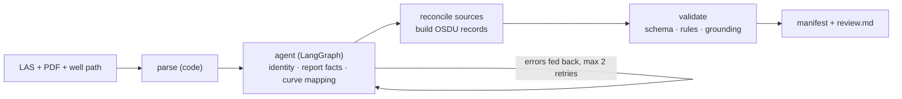

# volve-osdu-agent

An AI agent that converts Equinor's open **Volve** well data (LAS logs, well paths, petrophysical
report PDFs) into **OSDU** records, with provenance for every value, schema and business-rule
validation, human review of conflicts, and an evaluation against independent ground truth.

> On 13 Volve wellbores, with a small **local** model (qwen3 4B on a laptop GPU): **91%** of
> recoverable header values correct (95% CI 78-100%), **88%** of facts that must be read from report
> prose (vs 25% for a single-prompt LLM baseline), **0** emitted values absent from the inputs,
> **100%** of manifests valid, and **19/19** known and injected conflicts routed to human review.
> Numbers from [`docs/results.md`](docs/results.md); read its caveats.

## The problem

Operators are moving decades of well data into OSDU, the energy industry's open data platform.
Preparing legacy files for it is still largely manual: someone reads headers and reports, works out
which wellbore a file belongs to, and maps every value, unit and curve name into the right OSDU
field. It is slow, error-prone and hard to audit.

This project automates that step on Equinor's own open Volve dataset and measures how well it works.

## Demo: 15/9-F-12, before and after

**Before:** two LAS files, a 5-page image-heavy PDF report and a well path text file.

**After:** a valid OSDU load manifest (Organisation, Field, Well, Wellbore, 2 WellLogs, a
WellboreTrajectory, 3 Parquet datasets) plus a review report. One flag in it is a real problem in
Equinor's files:

> **warn · log_below_survey** · `WLC_PETRO_COMPUTED_INPUT_1.LAS` curve GR has data down to 4186.7 m
> MD, 666.7 m below the final survey station at 3520.0 m MD (4,375 non-null samples deeper)
> - 4186.7328 ← `WLC_PETRO_COMPUTED_INPUT_1.LAS` (LAS:~Curve/GR last non-null sample)
> - 3520.0 ← `F-12_ACTUAL` (WELLPATH:MD row 210)

A log that goes deeper than the hole's last survey station should never be ingested silently.

The same review shows the validators at work: the F-12 report is mostly images, and the small model
guessed TD 3500 m from a bare "3500", a kick-off point and KB elevation of 0 m, and the wellbore
as its own parent.
All four guesses were rejected by the grounding check, dropped and listed for review; the manifest
contains none of them.

- Full example run: [`outputs/example/15_9-F12/`](outputs/example/15_9-F12/) (manifest, records,
  provenance, review.md, LLM trace)
- Visual report: [`docs/demo/index.html`](docs/demo/index.html) (download and open in a browser)

## How it works

**LLM proposes, code computes, validators judge.**



- **Numbers come from code.** Depths, coordinates, sampling and curve ranges are parsed from the
  files. The LLM decides only what needs judgement: which wellbore this is, which facts a report's
  prose states for *this* wellbore (one report often covers three), and which OSDU unit and curve
  family each mnemonic is.
- **Grounding.** A fact from a report is kept only if the LLM quotes the page verbatim and the value
  is inside the quote. Otherwise it is sent back with the reason, and after two retries dropped and
  flagged.
- **No invented codes.** Every reference value (unit, curve family, measurement type, CRS) must exist
  in the pinned OSDU reference lists; near-misses get suggestions and a retry.
- **Abstain instead of guessing.** A value no input states stays empty, with the reason recorded.
- **Provenance for everything.** Every field of every record points to its source file, locator
  (LAS mnemonic, PDF page + quote, well path row) and method (parsed, llm_extracted, derived).
- **Human review is a feature.** Disagreeing sources, logs below the well path, plan well paths,
  converted units and assumed datums become review flags with every candidate value and its source.

Details: [`docs/architecture.md`](docs/architecture.md).

## Results

Generated by `uv run volve-osdu eval` (cached; a re-run makes 0 LLM calls). 95% bootstrap CIs over
wellbores, n = 13.

| Metric | rules | llm_only | agent |
|---|---|---|---|
| Field accuracy (recoverable, undisputed) | 94% [85, 100] | 72% [61, 83] | **91%** [78, 100] |
| Report-prose facts (KB, TD, KOP) | 100% [100, 100] | 25% [6, 50] | **88%** [57, 100] |
| Abstention (value not in the inputs) | 100% | 100% | 100% |
| Report facts grounded (kept / proposed) | n/a | 12% (4/33) | **75%** (27/36) |
| Emitted values found in no input | 0% | 0% | 0% |
| Manifests valid | 13/13 | 13/13 | 13/13 |
| Review-flag precision / recall | 19/19 · 19/19 | 18/18 · 18/19 | 19/19 · 19/19 |
| Curve unit / family accuracy* | 100% / 52% | 26% / 33% | 73% / 32% |

How to read it:

- **The agent vs one big prompt.** The single-prompt baseline proposes report facts that mostly fail
  the grounding check (4 of 33 kept); the agent's focused prompts, retrieval and feedback keep 27 of
  36. Neither can emit an ungrounded value: the shared validators drop it and raise a flag.
- **The rules baseline is optimistic.** Its regexes were written after reading these same reports
  (there is no held-out set), so it is an upper bound for hand-written rules on *this* data, not a
  general one.
- **Curves are the weak spot of a 4B model.** \*Curve labels are AI-drafted, not yet reviewed by
  the owner, and share conventions with the rules dictionary, so the rules curve scores are not
  independent. Many rock-physics curves (`LFP_*`) stay unmapped by the agent: abstained, not
  invented.
- Changes made after seeing results (semantic grounding checks, an identity fallback, a lenient
  baseline parser) are listed in the report, with the earlier agent run kept in
  [`docs/results_agent_run1.md`](docs/results_agent_run1.md).

Full report with per-field tables, disputed gold, every error and the run configuration:
[`docs/results.md`](docs/results.md). Illustrated version with charts:
[`docs/report.html`](docs/report.html) (download and open in a browser). Raw numbers:
[`docs/results.json`](docs/results.json).

## What the evaluation found in Equinor's data

The inputs and the official ground truth (Norwegian Offshore Directorate, NPD) disagree in places.
These rows are reported separately, never "fixed" to match the system:

- **Mixed datums.** No Volve LAS header states a datum. The 15/9-F-12 coordinates match NPD's ED50
  values; the 15/9-19 coordinates match NPD's ED50 position *converted to WGS84* (within ~3 m).
  Treating both the same way would move a well by ~100 m. Every location now carries a
  `crs_assumed` review flag.
- **15/9-F-11 vs its technical sidetrack.** NPD gives 15/9-F-11 a TD of 4562 m, but the report,
  well path and logs end the original hole at ~347 m. 4562 m is the TD of 15/9-F-11 T2, which NPD
  does not register separately.
- **Report vs NPD.** Kick-off points for F-1 B (2617 vs 2604 m), F-11 A (2586 vs 2578 m) and F-11 B
  (2585 vs 2586 m); KB elevation for F-12 (54.9 vs 54.0 m) and 15/9-19 SR (25.0 vs 22.0 m).
- **Inside one bundle.** 15/9-19 SR's two LAS files disagree on field (VOLVE vs Q15) and operator
  name.

## Quickstart

Needs [uv](https://docs.astral.sh/uv/) and git. About 800 MB of data is downloaded.

```bash
git clone https://github.com/wgKaminari/volve-osdu-agent && cd volve-osdu-agent
uv sync
bash scripts/download_data.sh                                  # pinned data, schemas, reference lists
uv run volve-osdu run --wellbore "15/9-F-12" --system rules    # no LLM needed -> outputs/<run_id>/
uv run pytest -q
```

To run the agent, copy `.env.example` to `.env` and point it at any OpenAI-compatible endpoint
(Azure AI Foundry, a hosted provider, or local [Ollama](https://ollama.com)), then:

```bash
uv run volve-osdu run --wellbore "15/9-F-12" --system agent
uv run python scripts/build_gold.py                 # held-out ground truth -> data/gold/
uv run volve-osdu eval                              # all systems -> docs/results.md
uv run volve-osdu eval --no-run                     # re-score existing outputs
```

Every LLM call is cached in `.cache/llm/` (key = model + messages + parameters), so a repeated run
makes no API calls.

## Evaluation design

- **Systems:** `rules` (no LLM: regex on report text and a static curve dictionary), `llm_only`
  (one prompt per wellbore, no retries or lookups) and `agent` (the graph). All three go through the
  same parsing, record building and validators, so the comparison isolates the judgement layer.
- **Ground truth, held out:** NPD wellbore headers and Equinor's Well_picks file, read only by
  `src/volve_osdu/eval/`. A test (`tests/test_leakage.py`) records every file a run opens and fails
  if a gold file is among them.
- **Recoverable vs not:** a gold value no input states (e.g. surface location for wellbores whose
  LAS has none) must be left empty and is scored as abstention.
- **Conflicts:** 3 real conflicts plus 14 perturbed copies of real bundles (feet instead of metres,
  swapped coordinates, a plan well path, contradictory headers, 2 negative controls) measure review
  flag precision and recall.
- **Statistics:** 95% bootstrap confidence intervals over wellbores (2,000 resamples).

## Limitations and responsible use

- **Small n.** 13 wellbores, header gold for 11. Intervals are wide; read them, not the point values.
- **No held-out development set.** The rules baseline was written after reading these bundles, so it
  is optimistic. Curve labels are AI-drafted and await owner review (`reviewed=false` in
  `data/gold/curve_labels.csv`); results that depend on them are provisional.
- **Model.** The reported run uses a small local model (see `docs/results.md`); a stronger model is a
  `.env` change away and may score differently.
- **CRS is an assumption.** LAS headers state no datum; locations are recorded as ED50 and flagged.
- **ACL and legal tags are placeholders**, as in Equinor's own samples. No real OSDU instance is
  called; the output is files.
- **Scope.** LAS + PDF + well path for 13 wellbores. DLIS files, Word reports, formation tops
  (WellboreMarkerSet) and image-only report pages are not read.

## Project layout

```
src/volve_osdu/ingest/     LAS, PDF, well path readers and the bundle inventory
src/volve_osdu/extract/    parsed LAS facts, rules baseline (regex + curve dictionary)
src/volve_osdu/agent/      LangGraph agent, llm_only baseline, cached LLM client, prompts/
src/volve_osdu/osdu/       IDs, reference lists, record builders, Parquet bulk, manifest
src/volve_osdu/validate/   JSON schema, business rules, grounding
src/volve_osdu/eval/       gold, perturbations, metrics, bootstrap, report (only place gold is read)
scripts/                   data download, gold build, curve-label draft, demo page
```

## Data attribution and credits

- **Volve data:** Equinor and the Volve licence partners, released under the
  [Equinor Open Data Licence](https://www.equinor.com/energy/volve-data-sharing). Raw data is not
  redistributed here; `scripts/download_data.sh` fetches it from the pinned commits of
  [andymcdgeo/spwla_volve](https://github.com/andymcdgeo/spwla_volve) and
  [awgeo/Volve_field_data](https://github.com/awgeo/Volve_field_data).
- **Ground truth:** NPD / Norwegian Offshore Directorate (Sodir) wellbore data
  ([factpages.sodir.no](https://factpages.sodir.no)), Norwegian Licence for Open Government Data.
- **OSDU:** schemas and Pydantic models from Equinor's
  [osdu-python-models](https://github.com/equinor/osdu-python-models) (v0.8.1, M27.1), manifest schema
  from [equinor/osdu-mcp-poc](https://github.com/equinor/osdu-mcp-poc), reference values from OSDU
  [data-definitions](https://community.opengroup.org/osdu/data/data-definitions) v0.30.1.
- **Libraries:** lasio, pdfplumber, LangGraph, jsonschema, pandas, pyarrow.

Code licence: Apache-2.0.
